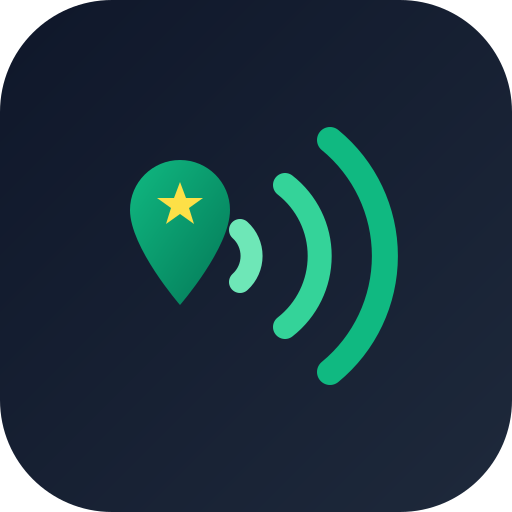

# Prospector NFC · Rutas & Reseñas Google

Aplicación web móvil (PWA) de alto rendimiento para vendedores en campo de tarjetas NFC para reseñas de Google Maps. Encuentra negocios de servicio cercanos, prioriza automáticamente aquellos que **más reseñas necesitan**, detecta **plazas pequeñas (<15 locales)**, traza rutas de visita en transporte público/a pie y genera al instante el **Place ID** y **enlace directo de reseña** listo para grabar con la aplicación **NFC Tools**.



---

## Características Principales

1. **Diseño Mobile-First Ergonómico:**
   - Optimizado para uso rudo en calle con una sola mano en **Android** y **iPhone**.
   - Alto contraste diseñado para legibilidad bajo luz solar directa.
   - PWA instalable con soporte offline para el app shell.

2. **Algoritmo de Priorización de Prospectos (`scoring.js`):**
   - **Necesidad de Reseñas (45%):** Penaliza negocios con cientos de reseñas y eleva al tope aquellos con **0 a 15 reseñas** (clientes ideales para comprar tarjetas NFC).
   - **Calificación Actual (15%):** Prioriza negocios con calificación comprometida (<4.4 estrellas) que necesitan subir su promedio.
   - **Detección Inteligente de Plazas Comerciales Pequeñas (15%):** Agrupa locales mediante metadata oficial `containingPlaces` y proximidad (<45m). Si la plaza tiene menos de 15 negocios, recibe una bonificación especial ("Plaza chica"); los grandes centros comerciales se penalizan por baja tasa de conversión.
   - **Proximidad al Vendedor (20%):** Ordena de menor a mayor distancia física desde la ubicación GPS del vendedor.
   - **Ficha Incompleta (5%):** Detecta negocios sin sitio web o sin teléfono comercial registrado.

3. **Herramienta Integrada para NFC Tools:**
   - Botón de un solo toque: **"Copiar link de reseña"** con el formato canónico oficial:
     `https://search.google.com/local/writereview?placeid=ChIJ...`
   - Botón para copiar el **Place ID** individual.
   - Cero fricción: pegar directamente en la pestaña "Escribir" de NFC Tools.

4. **Navegación y Rutas Inteligentes (`ruta.js`):**
   - Algoritmo de optimización de ruta: **Vecino más cercano + 2-opt** para recorrer todos los prospectos en el menor tiempo.
   - **Desglose de Transporte Público:** Integrado con Google Routes API para indicar líneas de Metro, Metrobús, número de paradas y tiempos a pie.
   - Botón directo para iniciar la navegación guiada en la app nativa de **Google Maps**.
   - Bitácora de visita por comercio: marcar como *Vendido 🎉*, *Interesado 🤔* o *No interesado ❌*.

5. **Transparencia y Datos Reales:**
   - Únicamente consume información oficial verificada de Google Places API (New).
   - Aclara con honestidad que Google no publica nombres ni correos personales de los dueños de negocios, evitando falsas expectativas.

---

## Estructura del Proyecto

```
nfc-prospector/
├── docs/
│   ├── CONTRATO.md              # Especificación técnica compartida
│   └── GUIA_GOOGLE_CLOUD.md     # Guía paso a paso de API Keys y Cloudflare
├── functions/                    # Backend en Cloudflare Pages Functions
│   ├── _lib/
│   │   ├── auth.js              # Validación de x-codigo (tiempo constante)
│   │   ├── giros.js             # Mapeo a Table A de Google Places (New)
│   │   ├── google.js            # Consumo y normalización de Places & Routes
│   │   └── uso.js               # Control de cuota diaria anti-cobros con KV
│   └── api/
│       ├── acceso.js            # POST: Validación de código de vendedor
│       ├── config.js            # GET: Catálogo de giros y configuración
│       ├── buscar.js            # POST: Búsqueda con Places API (New)
│       └── ruta.js              # POST: Cálculo de transporte con Routes API
├── public/                       # Frontend Web Móvil
│   ├── css/
│   │   └── app.css              # Sistema visual de alto contraste para campo
│   ├── js/
│   │   ├── api.js               # Cliente HTTP con manejo de auth
│   │   ├── app.js               # Controlador de vistas y eventos
│   │   ├── mapa.js              # Integración de Google Maps JS
│   │   ├── ruta.js              # Heurística 2-opt y formateo de URLs
│   │   └── scoring.js           # Algoritmo puro de puntuación y plazas
│   ├── icons/
│   │   └── icon.svg             # Icono de la PWA
│   ├── index.html               # Vistas: Buscar, Mapa, Ruta y Bottom Sheet
│   ├── manifest.webmanifest     # Manifiesto PWA
│   └── sw.js                    # Service Worker con cache de app shell
├── tests/                       # Pruebas automatizadas (node:test)
│   ├── backend.test.mjs
│   ├── ruta.test.mjs
│   └── scoring.test.mjs
├── .dev.vars.example            # Plantilla de variables de entorno locales
├── package.json
└── README.md
```

---

## Ejecución de Pruebas

Para verificar la integridad de todos los módulos:
```bash
npm test
```
Ejecuta 14 pruebas unitarias que validan la matemática de haversine, detección de plazas, pesos del algoritmo, ordenamiento 2-opt, generación de URLs para Google Maps y autenticación.

---

## Cómo Probar en Local

1. Copia `.dev.vars.example` a `.dev.vars` y coloca tus claves de Google (revisa `docs/GUIA_GOOGLE_CLOUD.md`).
2. Inicia el servidor de desarrollo de Cloudflare:
   ```bash
   npx wrangler pages dev public --port 8788
   ```
3. Abre en tu navegador móvil o escritorio: `http://localhost:8788`.
